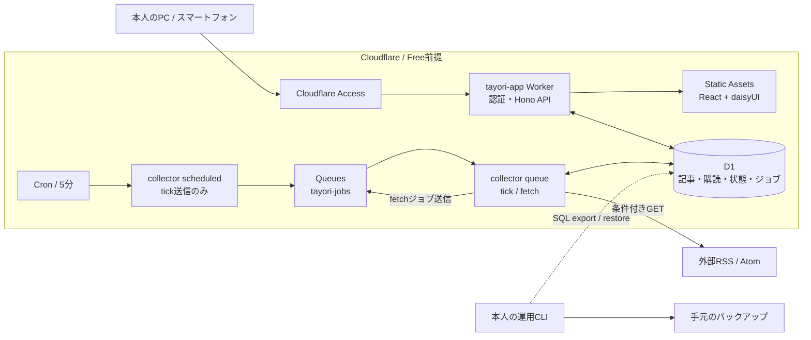

# Cloudflareアーキテクチャ

状態: 初期実装。Cloudflareの制限値と本番挙動は[公式資料](10-references.md)を参照し、実環境での確認は未実施。

## 1. システム構成

| リソース | 責務 |
|---|---|
| tayori-app Worker | API、Access JWT確認、Static Assets経由のReact UI配信 |
| tayori-collector Worker | scheduledはtick送信のみ。queueで配信対象選定・取得・整理 |
| D1: tayori-db | 購読・記事・既読・保存・収集ジョブ・予算を集約するデータベース |
| Queues: tayori-jobs | tick / fetchメッセージ。本文を入れない |
| Cloudflare Access | 本人のメールアドレスだけを許可 |

Web UI と API は同じオリジンで提供する。初期実装では Workers Static Assets を使い、Pages には配置しない。API はすべてのリクエストで Access JWT を検証する。workers.dev 上の静的アセット自体は Access で保護されない可能性があるため、公開前に Access で保護したカスタムホスト名を用意する。初期実装では GCP、VM、R2、KV、Durable Objects、AI を使わない。

## 2. Cronの役割を限定

FreeのHTTP・Cron CPUは10ms。XML解析やOPML一括処理をここへ集めない。Cronは5分ごとに小さいtickメッセージを送る。収集対象のD1検索、ジョブ作成、期限整理はQueue consumerで行う。

Queues公式制限ページは保持期間を除きFree/Paid共通とし、consumerの標準CPU上限30秒を記載している。一方Workers一般ページにはPaid向けCPU設定の説明もあるため、**Freeアカウント上のconsumer実行と設定の受理を最初に実証する**。検証前にCPU上限を拡張する設定は入れない。[Workers制限](https://developers.cloudflare.com/workers/platform/limits/) / [Queues制限](https://developers.cloudflare.com/queues/platform/limits/)

## 3. Queue設計

- 1つのQueueを使い、`type: tick | fetch` と `schemaVersion: 1` で処理を分岐。
- `tick`: 5分ごとに投入。期限切れジョブ回収、取得期限の購読先を最大10件選定、期限切れ記事の小分け整理。
- `fetch`: `jobId, sourceId, generation` を持つ。1メッセージ1購読先。
- 初期consumer batch sizeは1、concurrencyは1。アプリの取得タイムアウト20秒、全処理目標60秒以内。少数規模では並列度より整合性を優先。
- 技術障害のQueue再試行は最大1回を設計案とする。429/5xxなど既知の取得失敗はD1に次回予定を記録してackする。
- DLQは初期には置かない。消失・保持期限切れはD1の未完了ジョブから再作成する。
- 重複配信と順序入れ替わりを前提とする。メモリ上のフラグをロックに使わない。

## 4. D1とQueue間の整合性

D1 への書き込みと Queue への送信を1つのトランザクションにまとめられないため、D1 の `fetch_jobs` に送信待ちジョブを記録する。

1. tick処理はD1の条件付き更新とbatchで購読先を確保し、ジョブ作成・日次予算予約を同時確定する。対象が取得済み/停止中なら作成しない。
2. 未送信ジョブを Queue へ送る。送信に成功したら、状態を `sent` に更新する。
3. 送信前の停止なら次tickで再送。送信成功後の記録失敗なら同じjobIdで重複送信され得る。
4. consumerはD1でジョブを条件付きclaimし、leaseとgenerationを取得。完了・古いgenerationは処理しない。
5. 記事書込と最終状態変更は有効なgenerationを条件に実施し、古いconsumerの更新を拒否。
6. 保存成功後にack。保存後ack前の停止でも、再配信は完了記録により無害になる。

D1 batchの原子性だけでは競合防止にならない。各更新の条件、変更件数、予約失敗時のロールバックを結合テストする。[D1 batch](https://developers.cloudflare.com/d1/worker-api/d1-database/)

## 5. RSS取得

HTTP(S)の公開URLのみ。URLとリダイレクト先を検証し、認証付きURL・既知の内部IP・localhostを拒否する。DNS再束縛を含む制約は残るため、取得対象の検証は継続課題とする。公開のURL取得プロキシとしてAPIを提供しない。

- ETag / Last-Modifiedを購読先ごとに保存し、条件付きGET。
- 304では記事解析なし。200ではRSS/Atomを解析し、安定キーで重複排除。
- 展開後本文2MiB、リダイレクト3回、記事200件/応答、文字列上限を設定案とする。
- 上限超過・不正XML時はエラーにし、ETagを更新しない。黙って切り捨てて成功扱いしない。
- 保存はパラメータ上限と50クエリ/実行に合わせた複数行INSERT。収まらない処理はチェックポイントを伴って分割する。
- 分割書込は冪等にし、全記事保存完了後にだけ新ETag・Last-Modified・成功時刻を確定。
- HTMLを安全なプレーンテキスト要約へ変換。外部画像は初期表示で自動ロードしない。

## 6. 認証と公開経路

AccessでUIとAPI全体を保護。メールPINを初期候補とし、許可メールアドレスは未設定。Worker側でも署名・issuer・audience・期限・本人の識別を確認し、未設定/無効時はfail closedとする。検証済みのプラットフォームidentity機能を使う場合も同じ受け入れ条件を満たす。

Web Workerはworker-firstで認証確認後にassets/APIへ分岐する案。この構成では静的ファイルもWorker呼出し分を見積もる。collectorのHTTP公開は無効化し、public route・workers.dev・preview経由の収集起動を作らない。

Cookie認証の更新APIは同一Origin確認、JSON Content-Type、CSRF対策を実施。APIレスポンスはprivate/no-store。秘密鍵・APIトークンをブラウザへ渡さない。
