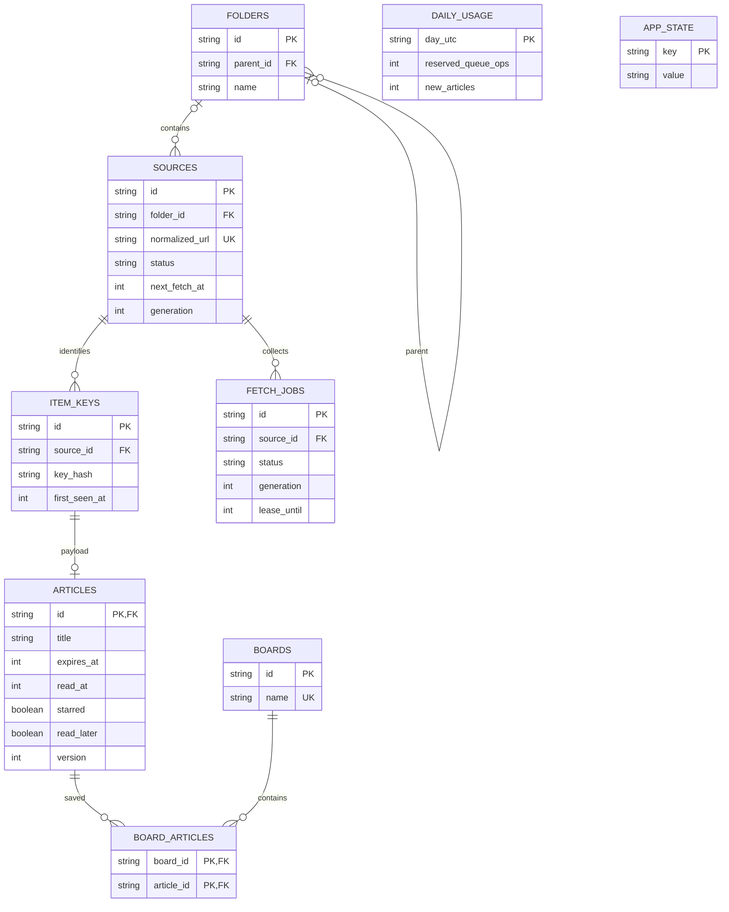

# データ設計

## 1. ER図

## 2. 論理テーブル

IDはUUID等の不透明文字列、日時はUTCのUnix時刻（秒）に統一する。個人用のためユーザーテーブルは初期に設けない。

| テーブル | 主な列・制約 |
|---|---|
| folders | id, parent_id nullable, name, sort_order。循環禁止。親ごとの名前一意（ルートも正規化して制約） |
| sources | id, kind=rss, normalized_url UNIQUE, title, folder_id, status(active/paused/archived), interval_minutes, next_fetch_at, last_checked_at, last_success_at, etag, last_modified, error_code, error_count, generation |
| item_keys | id, source_id, key_hash, first_seen_at。UNIQUE(source_id,key_hash)。本文削除後も残す |
| articles | id=item_keys.id, title, url, summary_text, published_at nullable, content_hash, read_at nullable, starred, read_later, first_seen_at, expires_at, updated_at, version |
| boards | id, name UNIQUE, sort_order |
| board_articles | board_id, article_id, created_at。複合主キー |
| fetch_jobs | id, source_id, generation, status(pending/sent/running/done/failed), lease_until, attempts, created_at, completed_at。稼働中ジョブは購読先ごとに1件 |
| daily_usage | day_utc PK, reserved_queue_ops, new_articles, observed_rows_read, observed_rows_written。上限付き原子的加算 |
| app_state | key PK, value。収集停止、整理カーソル、最終tick等の少数の状態 |

実装の出発点として [`migrations/0001_initial.sql`](../migrations/0001_initial.sql) を用意した。API実装に合わせて制約や列を見直し、テスト用データで適用を検証する。

## 3. 記事キー

優先順はAtom id / RSS guid → 解決済み記事URL → タイトルと配信日時等の安定項目。キー種別を付けてSHA-256化する。GUIDはURLとして扱わず不透明文字列のまま使う。

URLはフラグメント除去、host正規化等の安全な範囲だけを正規化し、意味のあるqueryを無差別に削除しない。購読先間では重複排除しない。IDやURLが変わる配信元では完全一致の保証はできず、フィクスチャで限界を記録する。

- 新規キー: item_keysとarticlesを同じ原子的単位で作成する。キーだけ先に確定しない。
- 既存キー＋記事あり: 内容変更時のみ更新し、既読・保存状態・初回取得日時・期限を維持。
- 既存キー＋記事なし: 期限削除済みなので再作成しない。

item_keysは購読解除後も保持する。増加は容量監視の対象。自動期限削除で再出現防止を破らない。将来の「履歴を完全消去」は再取り込みの可能性を伴う明示操作として別途設計する。

## 4. 保持と同時更新

expires_at=first_seen_at+604800。read_atは保持に影響しない。

削除条件は `expires_at <= now AND starred=0 AND read_later=0 AND ボード所属なし`。一覧も同じ条件で期限切れを除外する。200行程度ずつ削除し、item_keysは残す。ボード所属の有無は削除SQL内で再評価し、事前取得した古い判定だけで消さない。

保存APIと整理が競合した場合、保存が先なら保持、削除が先なら404を返す。成功していない保存をUIで確定表示しない。公開日時が欠ける記事は一覧の表示順にfirst_seen_atを使う。

## 5. インデックス案

- sources(status,next_fetch_at)、sources(folder_id)
- articles(first_seen_at DESC,id DESC)
- articles(read_at,first_seen_at DESC,id DESC)
- articles(expires_at)、item_keys(source_id,key_hash) UNIQUE
- board_articles(article_id) と複合主キー(board_id,article_id)
- fetch_jobs(status,lease_until)、fetch_jobs(source_id,generation)

一覧はcursor pagination。OFFSETで全履歴を走査しない。フォルダ階層の検索は循環を排除した再帰CTEを候補とし、実測で読取行数を確認する。保存フラグの追加インデックスは必要になるまで増やさない。

## 6. 削除と復元

folders削除は所属を親へ移動。boards削除はboard_articlesを削除。sourcesはアーカイブ化して保存記事・識別情報を保持。articlesの物理削除ではboard_articlesをCASCADEにできるが、通常の期限整理は所属ありを対象にしない。

SQLバックアップには全テーブルを含める。復元後は古いrunning/sentジョブを失効し、generationを更新してQueue内の旧メッセージを拒否する。
