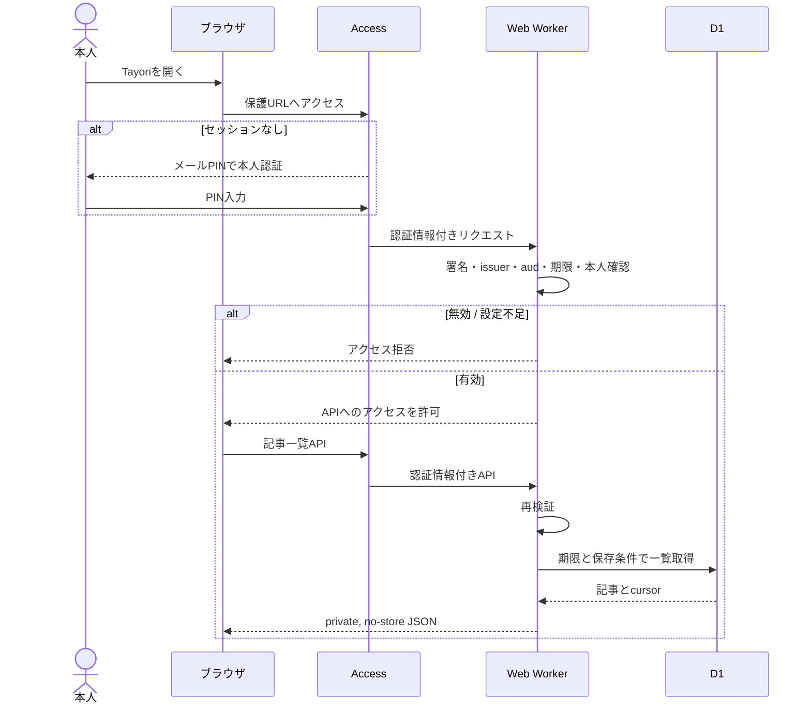
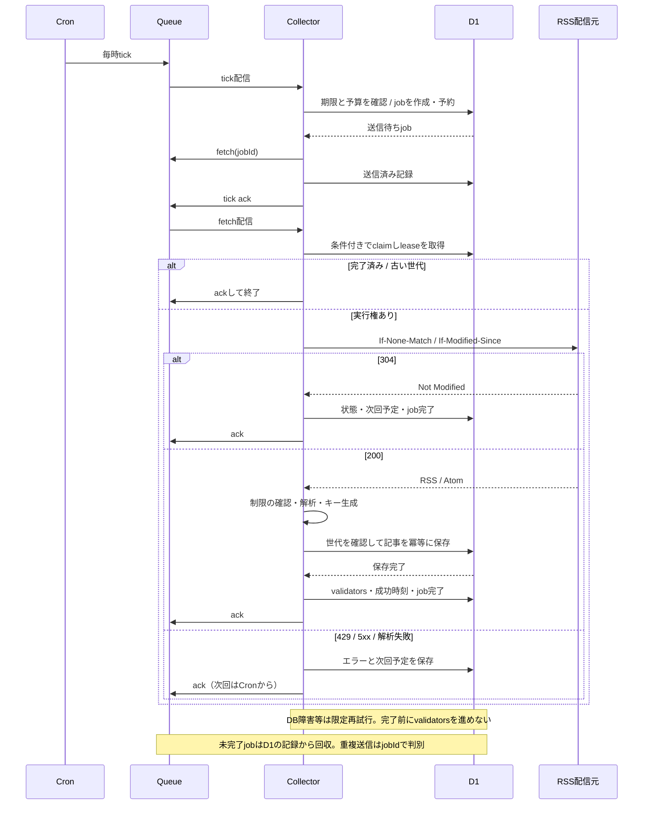
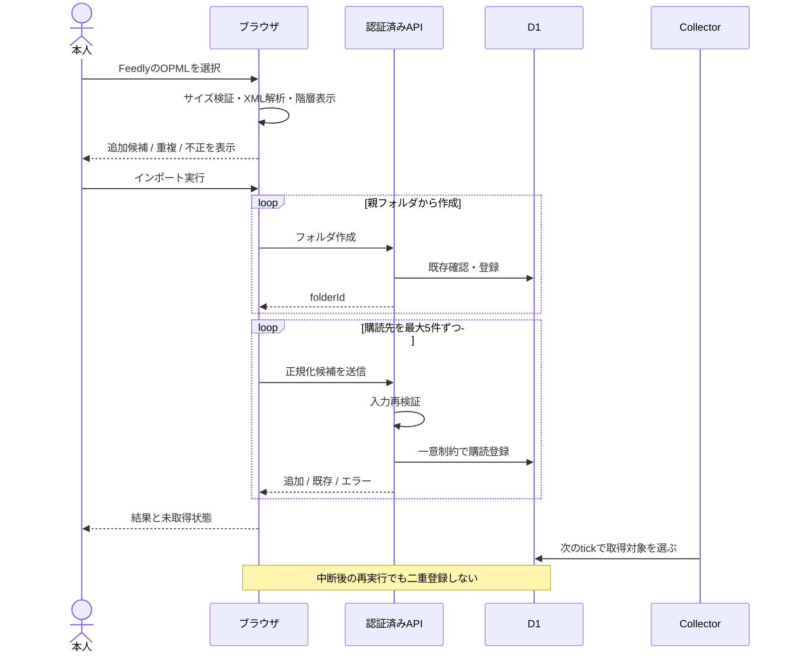
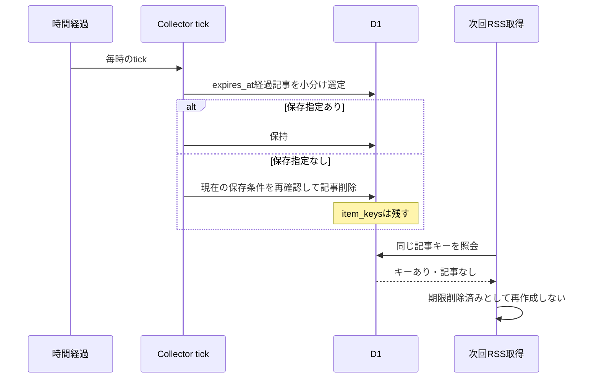

# シーケンス図

実装では、成功する場合に加えて、重複配信や保存失敗も検証する。

## 1. ログイン・記事表示

静的アセットはWorkerを経由せず配信されるため、図のAccessによるUI保護は実環境での確認が必要である。

初期 UI は、再読み込み時と画面に戻ったときに状態を同期する。古いレスポンスによる上書きは `version` で防ぐ。

## 2. 定期収集

tick が遅延または重複しても、期限とジョブの状態は D1 の値を基準に処理するため、メッセージの順序保証には依存しない。lease が切れたジョブは新しい generation で回収し、古い Worker からの書き込みを拒否する。

### 収集スケジュールの適用

CollectorのCronは毎時00分に起動する。間隔モードはUTC epochを基準に、指定時間数の倍数となる次の時間境界に合わせる。例えば6時間間隔ならJST 03:00・09:00・15:00・21:00となる。
保存直後の最初の待ち時間は指定間隔より短い場合がある。日次モードは保存時刻より後の最初のJST指定時刻を選ぶ。

Collectorは処理完了時刻ではなく時間境界から次の予定を計算するため、Queue待ちによる遅延が次の間隔を延ばさない。予定は取得開始の目安であり、Queue待ちやRSS応答によって取得完了は遅れる。

設定変更時、pending・sent・runningのジョブは取り消さず、一度完遂してから新しい予定へ移る。設定保存では追加ジョブを作らない。処理中に設定が変更された場合、完了したジョブは保存し直された次回予定を上書きしない。
Collectorはジョブ作成時にも設定スナップショットをSQLで照合する。

失敗時は段階的な待機とRetry-Afterを守り、定期収集の予定と失敗後の待機期限の遅い方を次回取得とする。待機期限は `sources.retry_not_before` に保存し、設定変更でも短縮しない。
日次設定でも通常は次の日次予定まで待ち、待機期限がその予定を越える場合は期限後の毎時Cronで再試行する。

古い時間帯の遅延tickは破棄し、現在の時間帯のtickで期限超過の購読先を1回だけ取得する。過去の予定の回数分は再実行しない。有効ジョブの一意制約、generation検証、Queue予算予約、
記事キーとcontent_hashによって重複を防ぐ。

## 3. OPML移行

ブラウザでの解析は、インポート操作の前処理として行う。サーバー側でも URL、サイズ、フォルダの所属、重複を検証する。インポート API の処理中に RSS の取得完了を待たない。

## 4. 保存期限・記事再出現防止

保存操作と削除が競合した場合は、SQL 実行時点の状態で結果を決める。`item_keys` はバックアップ対象であり、復元時に失うと古い記事が再登録される可能性がある。
