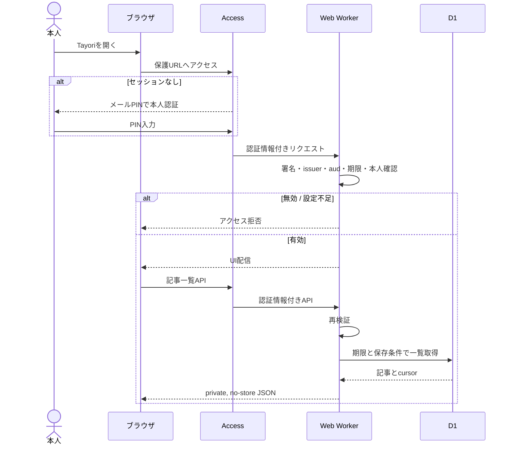
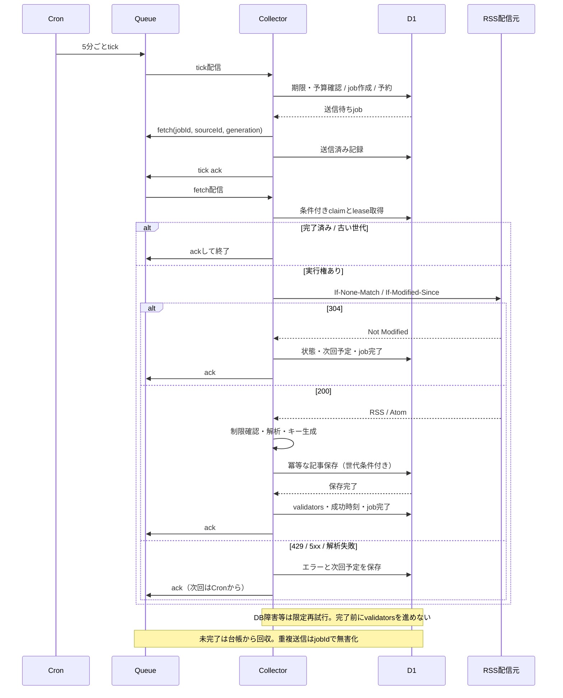
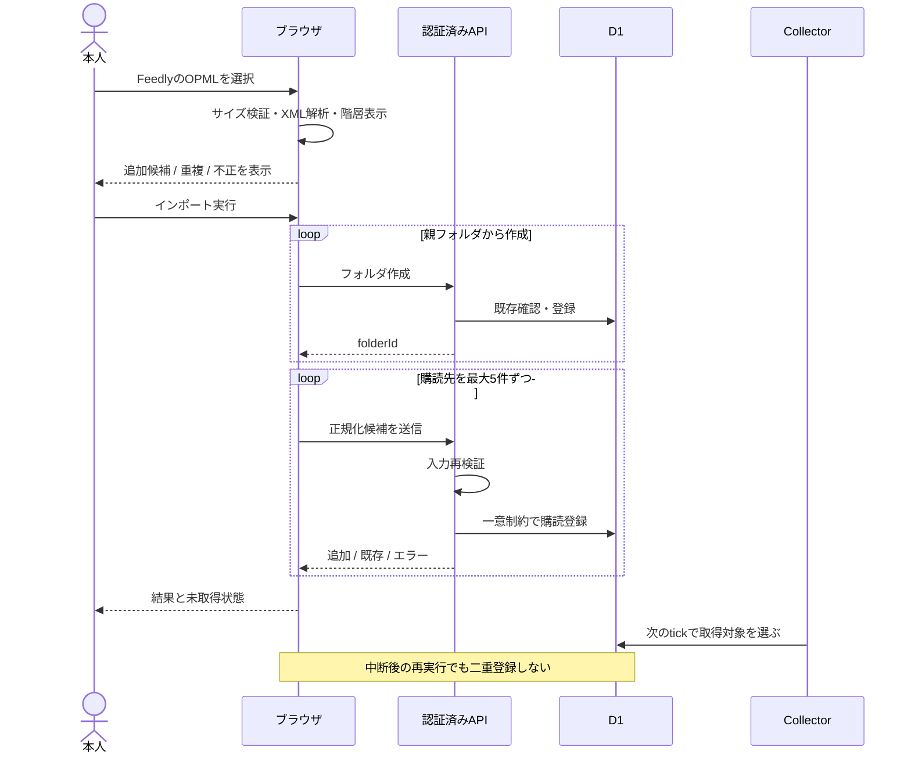
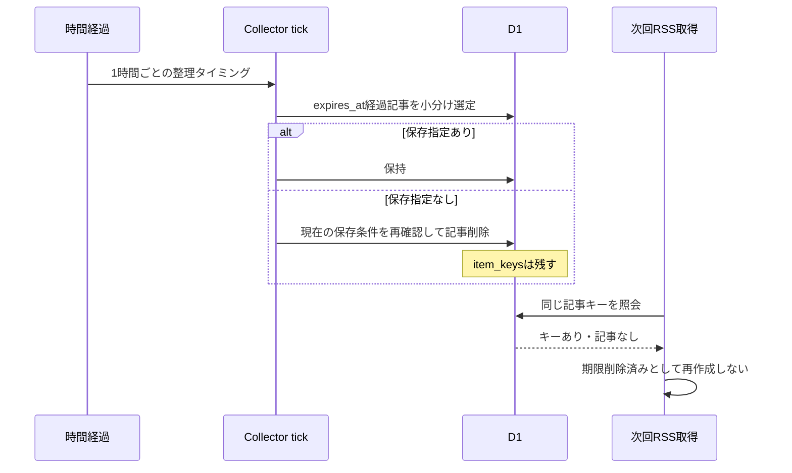

# シーケンス図

編集元は[diagrams](diagrams/README.md)。実装の成功経路だけでなく、重複配信と保存失敗も検証する。

## 1. ログイン・記事表示

初期UIは再読込・フォーカス復帰で状態を同期。レスポンスが古い場合の書戻しはversionで防止する。

## 2. 定期収集

tickが遅延/重複してもD1の期限・ジョブ状態が正本。順序保証に依存しない。lease切れは新generationで回収し、古いworkerは書き込めない。

## 3. OPML移行

ブラウザによる解析は操作のための前処理。サーバー側でURL・サイズ・フォルダ所属・重複を再検証する。RSSネットワーク取得をインポートAPI内で待たない。

## 4. 保存期限・記事再出現防止

保存操作と削除の競合はSQLの現在状態で決定。item_keysはバックアップ対象であり、復元時に失うと古い記事が再登録され得る。
